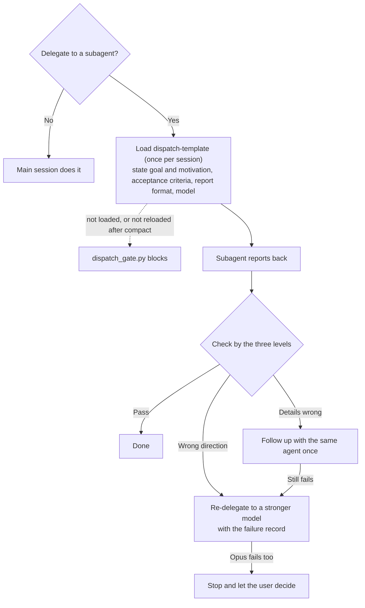

[繁體中文](README.md) | English

# claude-workflow-template

A Claude Code workflow setup for graduate students. Install it into your own project folder (thesis, literature notes, reports) and it works from there. Once installed:

- **Each session picks up where the last one stopped**: Claude reads the previous log at startup and tells you in a sentence or two where things stand and what's left.
- **Delegation has to be spelled out first**: before Claude hands work to a subagent, it must load the dispatch template and state the goal, the acceptance criteria, and the report format. If it skips the template, the call is blocked.
- **Finished work is checked by a different agent**: important output (thesis paragraphs, anything you publish) goes to a `verifier` that took no part in making it.
- **A few common mistakes are caught automatically**: invisible control characters written into files get blocked, and you get a reminder to save your progress when the conversation runs long.
- **Raw data can be locked**: folders or files you name at install time (PDFs, raw survey files) can't be changed by Claude through its edit tools or `>` redirection. A script that Claude writes, such as a Python script that opens the file itself, is not blocked.

Some terms: a **hook** is a small program Claude Code runs automatically at set points (session start, before a tool call, end of a turn); it can feed Claude extra information or block an action. A **subagent** is a separate assistant Claude starts, which does one job in its own conversation and reports back. **Context** is what Claude currently remembers of this conversation; when it gets too long, `/clear` wipes it and you start fresh.

**Language note**: everything this template installs is written in Traditional Chinese: the rules, the dispatch skill, the `verifier`, the CLAUDE.md template, hook messages, and `install.py` output. If Claude's replies drift into Chinese, add a line to your CLAUDE.md asking it to reply in English. You will see Chinese text in block messages and in the files under `.claude/`. The intro page and the docs in `docs/` are also in Chinese.

Intro page (Chinese): <https://wayhong0928.github.io/claude-workflow-template/>

## Who it's for

- You use Claude Code (the terminal version), and your project spans many sessions.
- Your project is mostly writing and research: theses, literature notes, reports. Code projects work too, but for pure programming a package like [Superpowers](https://github.com/obra/superpowers) is a better fit (comparison, in Chinese: [docs/vs-superpowers.md](docs/vs-superpowers.md)).
- Platforms: run on real hardware on native Windows; the hook and installer tests pass on WSL2 (Ubuntu); macOS has only had static checks. Hooks are Python. The session_log startup injection uses PowerShell, so macOS, Linux, and WSL need PowerShell 7 (`pwsh`) installed.

You don't need to know Git. To undo damage, see [Undoing a bad change](#undoing-a-bad-change).

## Before installing: check your environment

| Tool | What it's for | Required? | How to check | If you don't have it |
|---|---|---|---|---|
| Claude Code 2.1.292 or later | This setup is built for it | Yes | `claude --version` | Install per the [official guide](https://code.claude.com/docs/en/setup). To update: native install `claude update`; WinGet `winget upgrade Anthropic.ClaudeCode`; Homebrew `brew upgrade claude-code` |
| Python 3.8 or later | All hooks and the installer | Yes | Windows: `python --version` (or `py --version`); macOS, Linux, WSL: `python3 --version` | Windows: `winget install Python.Python.3.12`; macOS: `brew install python`; Ubuntu/WSL: `sudo apt install python3` |
| PowerShell | session_log startup injection | Only if you install session_log | Built into Windows; macOS, Linux, WSL: `pwsh --version` | macOS: `brew install powershell`; Linux/WSL: follow [Microsoft's Linux install guide](https://learn.microsoft.com/powershell/scripting/install/install-powershell-on-linux); or skip session_log |
| Git | Downloading this template | No | `git --version` | Download the ZIP instead |

On Windows, if typing `python` opens the Microsoft Store, Python isn't installed yet; that's just a built-in shortcut.

**If you use WSL**: run Claude Code, Python, and install.py all inside WSL, and keep the project on the WSL side. The installer writes the Python and PowerShell command names of the current environment into `.claude/settings.json`, so a setup installed in WSL breaks when used from native Windows Claude Code, and the other way round (see [Known limitations](#known-limitations)).

## Install option 1: let an AI install it (recommended)

Open Claude Code or Codex in **your project folder** (open a terminal there and type `claude` or `codex`) and paste in the whole block below. It checks your environment first, asks before installing anything missing, and waits for your OK at every step.

Codex can do the install, but what gets installed only works in Claude Code: Codex reads `AGENTS.md`, `.agents/skills/`, and `.codex/hooks.json`, not `.claude/`. Codex's default sandbox has no network access and can only write to the current folder, so it will ask you to approve the download of the template into a temp folder.

```text
Please install claude-workflow-template (https://github.com/wayhong0928/claude-workflow-template) into the current folder. Before each step, tell me what you are about to do and which command you will run, and wait for my OK. Don't edit any existing files in my project yourself; leave every change to its install.py (it makes backups first).

1. Check the environment and report each item as present/missing with its version:
   - Operating system, and whether this is WSL (on Linux, /proc/version containing "microsoft" means WSL). If it is WSL, the claude and python3 below must be the ones installed inside WSL, not on the Windows side.
   - Claude Code: claude --version, needs 2.1.292 or later.
   - Python: try python, python3, py in that order (py only on Windows), needs 3.8 or later. On Windows, if the Microsoft Store opens or it prints "Python was not found", count it as missing.
   - Git: git --version.
   - If not on Windows, also check pwsh --version.
2. If Python is missing or Claude Code is too old: stop, tell me how to install or update it (Python: winget install Python.Python.3.12 on Windows, brew install python on macOS, sudo apt install python3 on Ubuntu/WSL; Claude Code depends on how it was installed: claude update for a native install, winget upgrade Anthropic.ClaudeCode for WinGet, brew upgrade claude-code for Homebrew), and ask whether to do it now. If I say no, stop here.
3. If Git is missing: ask whether to install it (Windows: winget install Git.Git; macOS: xcode-select --install; Ubuntu/WSL: sudo apt install git). If I say no, that's fine; download the ZIP in the next step instead.
4. Download the template into a temp folder, not into my project. With Git, use git clone --depth 1; without it, download https://github.com/wayhong0928/claude-workflow-template/archive/refs/heads/main.zip and unzip it.
5. Ask whether I want session_log (each session automatically picks up the previous one; it adds session_log.md and TODO.md to the project). Give me a one-line recommendation: if this folder is not a git repo (for example a thesis folder or an Obsidian vault), recommend it; if it's a code repo, it can be skipped. If this isn't Windows and pwsh is missing, it can't be installed. Then ask whether there is raw data you must not change (PDFs, raw survey files, submitted documents), and if so, list the folders or files.
6. Dry run first: python <temp folder>/install.py <my project folder> --dry-run, plus --session-log or --no-session-log; for each raw-data path from step 5, add --protect <path>. Walk me through the actions it lists; once I agree, run it again without --dry-run. Replace python with the one you found in step 1.
7. In my project folder, run python .claude/hooks/tests/run_tests.py (again with the python from step 1). The last line should read "25/25 通過" ("通過" means passed; matching numbers mean everything passed). If it doesn't pass, paste the output to me and don't modify the hooks yourself.
8. If install.py says it created a new CLAUDE.md: the file is in Traditional Chinese. Ask me one question at a time to fill in the 【】 placeholders, explaining each line in English and writing my answers in English; delete any line I can't answer.
9. Delete the temp folder. Report what was installed, what already existed, where the backup is, and which steps failed or were skipped by me. Finally, remind me to quit Claude Code, type claude again in the project folder, and type /hooks to confirm.
```

**After the AI finishes, check this yourself**: in the project folder, start `claude` again and type `/hooks`. You should see five event types: `PreToolUse`, `PostToolUse`, `UserPromptExpansion`, `UserPromptSubmit`, `Stop` (plus `SessionStart` if you installed session_log).

## Install option 2: install it yourself

The commands below use Windows as the example. On macOS, Linux, and WSL, replace `python` with `python3` and write paths like `~/thesis/notes`.

1. Download: click the green **Code** button at the top of this page → **Download ZIP**, and unzip it anywhere (not inside your project). If you use Git, `git clone` works too.
2. Open a terminal in the unzipped folder (Windows: right-click an empty spot in the folder and choose "Open in Terminal"; macOS: open Terminal, type `cd ` with a trailing space, drag the folder into the window, and press Enter; Linux, WSL: `cd` into it), then do a dry run (replace the path with your project):

   ```
   python install.py "D:\thesis\notes" --session-log --dry-run
   ```

   It lists how many files it will add, which files it will overwrite, and which settings it will change, without touching anything. To skip session_log, replace `--session-log` with `--no-session-log`; if you give neither, it decides for you (it installs session_log when the project isn't in a git repo). If you have raw data that must not change, add options like `--protect pdf` (see [Protecting raw data](#protecting-raw-data)).
3. If it all looks right, run it again without `--dry-run`.
4. In the terminal, `cd "D:\thesis\notes"` to switch to your project folder and run `python .claude/hooks/tests/run_tests.py`. The last line should read "25/25 通過" ("通過" means passed; matching numbers mean everything passed).
5. Open `CLAUDE.md` in your project and fill in the 【】 placeholders (if install.py created it).
6. In the project folder, type `claude`, then `/hooks` to confirm.

### What install.py does

- Copies the files under `template/.claude/` into your project's `.claude/`.
- Merges the hook settings into `.claude/settings.json`. Your existing settings stay; it only adds these entries. If you passed `--protect`, it also adds protection rules to `permissions.deny` in the same file.
- Creates a `CLAUDE.md` only if the project doesn't have one. If the project already has an `AGENTS.md`, the first line of the new CLAUDE.md is `@AGENTS.md`, which imports it; without that line, Claude Code stops reading AGENTS.md automatically once a CLAUDE.md exists. When session_log is installed, it appends a handoff section to the end of CLAUDE.md, wrapped in `<!-- claude-workflow-template:start -->` and `<!-- claude-workflow-template:end -->` markers.
- When session_log is installed, creates `session_log.md` and `TODO.md` only if they don't exist.
- If the project is in a git repo, adds the local state files the hooks create to `.gitignore`.

Before overwriting or modifying anything, it backs up the old files to `.claude/backup/workflow-template-<timestamp>/`. Running it again doesn't add settings twice, so to update later, download the new version and run it again.

### Uninstalling

```
python install.py "D:\thesis\notes" --uninstall
```

This removes the template's hooks from settings.json, the files it installed in `.claude/`, and the marked section in CLAUDE.md. Protection rules in `permissions.deny` are left in place so your raw data stays protected; delete them from settings.json yourself if you no longer need them. `CLAUDE.md`, `session_log.md`, and `TODO.md` hold your content and are not deleted. If settings.json held only these hooks, you're left with a file containing `{}`, which you can delete. `.claude/backup/` holds the backups made before install and uninstall; delete it once you're sure you don't need them.

## Using it day to day

Alex Chen keeps the literature notes for a master's thesis in an Obsidian folder, without Git.

1. Install as above, with session_log. Fill in CLAUDE.md like this:
   - What this project is: "You are Alex Chen's literature-notes assistant. Project goal: every paper read has a note covering its research question, method, and main findings."
   - Rules that must not be broken: "All citations in APA 7th edition." `pdf/` must not change, so `--protect pdf` was added at install time and Claude Code blocks Claude's edits to it, whether or not Claude remembers the rule.
2. Always start `claude` in the notes folder, or the hooks and CLAUDE.md won't load.
3. At startup Claude says where the last session left off. Give it work as usual.
4. When a piece of work is done, tell Claude "update the log". It adds an entry at the top of `session_log.md` in the set format and updates `TODO.md`. You'll see that entry at the start of the next session.
5. When Claude delegates to a subagent, you'll see it load `dispatch-template` first. For important output, it sends the work to `verifier` before saying it's done.

The session_log entry format is described (in Chinese) in [template/.claude/session-log-kit/README.md](template/.claude/session-log-kit/README.md); when each mechanism fires is covered in [docs/how-it-works.md](docs/how-it-works.md).

### From delegation to acceptance



## Protecting raw data

Lock things that must not change, such as PDFs, raw survey files, and submitted documents, with `--protect` at install time. It takes folders or files, as many times as you like:

```
python install.py "D:\thesis\notes" --session-log --protect pdf --protect "data\survey_raw.csv"
```

It adds this to `.claude/settings.json`:

```json
"permissions": {
  "deny": ["Edit(/pdf/**)", "Edit(/data/survey_raw.csv)"]
}
```

`/pdf/**` means every file under `pdf/` in the project; a path outside the project is written as an absolute path like `//d/research-data/**`. When Claude changes a file with its edit tools or writes output into it with `>`, Claude Code blocks it, even in the mode that skips permission prompts (tested on Windows with Write, Edit, and `>`). To add more later, run install.py again with `--protect`; existing rules aren't duplicated. You can also edit settings.json directly in the format above.

What it can't block: Claude writing a script, such as a Python script, that opens the file and writes to it itself. The official [permissions docs](https://code.claude.com/docs/en/permissions#read-and-edit) say this kind of indirect write is out of scope. Blocking that too requires the OS-level [sandbox](https://code.claude.com/docs/en/sandboxing), which supports only macOS, Linux, and WSL2. So keep a backup of important raw files outside the project.

A line in CLAUDE.md saying "don't modify `pdf/`" is only a reminder; Claude won't always follow it. To actually block changes, use `--protect`.

## Undoing a bad change

Claude Code saves a checkpoint each time you send a message. If a file gets damaged, type `/rewind` (or press `Esc` twice while the input box is empty), pick the message to go back to, then choose whether to restore code, the conversation, or both. See the official [checkpointing docs](https://code.claude.com/docs/en/checkpointing).

What `/rewind` can't recover:

- Files Claude changed through commands (`rm`, `mv`, `cp`, scripts writing files). Only changes made with its edit tools are tracked.
- Files changed by a subagent, in most cases.
- Files you changed yourself outside Claude Code.
- Checkpoint file snapshots are cleaned up after about 30 days by default.

So keep a long-term version history separately: if you use Git, run `git init` in the project folder and ask Claude to commit after each piece of work; if you don't, at least copy the folder before a big change.

## Checking citations and claims

When a thesis section or a set of literature notes is done, ask Claude to send it to `verifier` to check the citations. `verifier` took no part in the writing and gets only the acceptance criteria and file paths. The more specific the criteria, the more accurate the check:

```text
Send chapters/ch2.md to verifier to check its citations:
1. Every (Author, Year) in the text appears in references.md, and every entry in references.md is cited in the text.
2. The claim next to each citation matches what the original paper in pdf/ says; for any mismatch, quote the sentence from the original.
3. For each entry in references.md with a DOI, the authors, year, and title on the DOI page match what references.md says.
```

It checks entry by entry by reading files and the web, with no automated script, so:

- It can't read full text behind a paywall and will mark those "can't determine". Put the PDF in the project and give its path in the criteria so it can check against the original.
- It can miss things. For key claims going into your thesis, spot-check a few citations it marked as passing.

## Long tasks: plan first, then run to completion with `/goal`

For work that touches many files, like revising a whole chapter or tidying a batch of literature notes, have Claude plan first, confirm the plan, then let it run on its own until the acceptance criteria are met. If you haven't worked out what to write yet, have Claude interview you and write an outline first. Steps are in the ["larger pieces of work"](docs/how-it-works.md#大的工作先讓-claude-訪談你) and ["long tasks"](docs/how-it-works.md#長任務先規劃再用-goal-跑到完成) sections of docs/how-it-works.md (Chinese).

## What's in the repo

```
install.py                 install and uninstall
template/                  what gets installed into your project
  .claude/
    hooks/                 four hooks, a shared module, tests
    skills/dispatch-template/  dispatch prompt templates, model selection table
    agents/verifier.md     the subagent that does acceptance checks
    rules/dispatch-and-verify.md  when to delegate to a subagent, how to verify
    session-log-kit/       session_log injection, writing, and archiving scripts
  hooks-core.json          hook settings install.py merges into settings.json
  hooks-session-log.json   same, for session_log
  CLAUDE.md.template       used when creating a new CLAUDE.md
  session_log.md.template, TODO.md.template
docs/
  how-it-works.md          the order things happen in a session, whether to install session_log, how to make your own version
  vs-superpowers.md        how this differs from Superpowers
tests/test_install.py      tests for install.py
index.html                 intro page
README.md                  this README in Traditional Chinese
README.en.md               this README in English
```

Starting `claude` inside this repo's folder doesn't enable any hooks. Everything sits under `template/` and only takes effect once installed into your project.

## Known limitations

- `rules/` and `dispatch-template` are rules written for Claude to read, and it won't always follow them. Only the hooks enforce anything.
- All hooks fail open: on an error they let the action through so they never block you, but you also get no warning when one breaks. Run the tests after changing a hook.
- `ctrl_char_stop.py` only checks files whose full path appears in the transcript. Paths built from variables inside a command are missed, and on macOS and Linux a path containing spaces is caught only if it's quoted. Files written by a subagent are recorded in a separate transcript and aren't checked either. It blocks at most once per turn.
- Even the built-in `Explore` and `Plan` subagents need `dispatch-template` loaded before they can be dispatched (only `fork` is exempt), so the first dispatch after entering plan mode may be blocked once; after the template loads, it goes through.
- Run install.py in the same environment where you run `claude`. settings.json records the command names found on PATH in that environment (often `python` and `powershell` on Windows, `python3` and `pwsh` on macOS and Linux). If the same project folder is opened from both Windows and WSL, or synced between Windows and a Mac through a cloud drive, every hook fails on the other side and the dispatch check stops working with them.
- What's been tested on real hardware: Claude Code itself only on native Windows; the hook and installer tests on Windows and WSL2 (Ubuntu); the two session_log `.ps1` scripts only on Windows PowerShell 5.1; macOS not yet.
- `--protect` rules can't block a script that opens a file and writes to it itself (see [Protecting raw data](#protecting-raw-data)). If a path contains `*`, `?`, `[`, or `]`, install.py won't write the rule for you; add it by hand.
- Claude Code only. Codex can run the install for you, but it doesn't read `.claude/`: rules go in `AGENTS.md`, skills in `.agents/skills/`, hooks in `.codex/hooks.json`. The dispatch check depends on Claude Code's Skill tool events, and the control-character check reads Claude Code's transcript (Codex's official docs say its transcript format is not a stable interface), so these two hooks can't simply be moved over.
- Everything installed is in Traditional Chinese (see the language note at the top).

## Reporting problems

If it won't install, or a hook blocks something it shouldn't (or misses something it should block), open an [issue](https://github.com/wayhong0928/claude-workflow-template/issues) with your OS and the output of `install.py` or the tests. Issues in English or Chinese are both fine.

## Related resources

All of these are in Traditional Chinese.

| Resource | For whom |
|---|---|
| [mis-thesis-guide](https://wayhong0928.github.io/mis-thesis-guide/) | A knowledge base on research methods and thesis writing, for looking up concepts and criteria |
| [One-hour quickstart](https://wayhong0928.github.io/mis-thesis-guide/pages/ai-quickstart.html) | Using only the ChatGPT, Claude, or Gemini web apps and wanting a thesis assistant set up within an hour (there's also a [Claude Code and Codex version](https://wayhong0928.github.io/mis-thesis-guide/pages/ai-quickstart-agent.html)) |
| [thesis-notes-template](https://github.com/wayhong0928/thesis-notes-template) | Wanting to take literature notes in Obsidian with ready-made templates and filling rules |
| [mis-thesis-skills](https://github.com/wayhong0928/mis-thesis-skills) | Using Claude Code or Codex and wanting the AI to check your topic and writing against fixed criteria |
| [claude-workflow-template](https://github.com/wayhong0928/claude-workflow-template) | Using Claude Code on a thesis or research project and wanting a ready-made workflow setup: session handoff, dispatch templates, independent verification |

## License

MIT, see [LICENSE](LICENSE).
