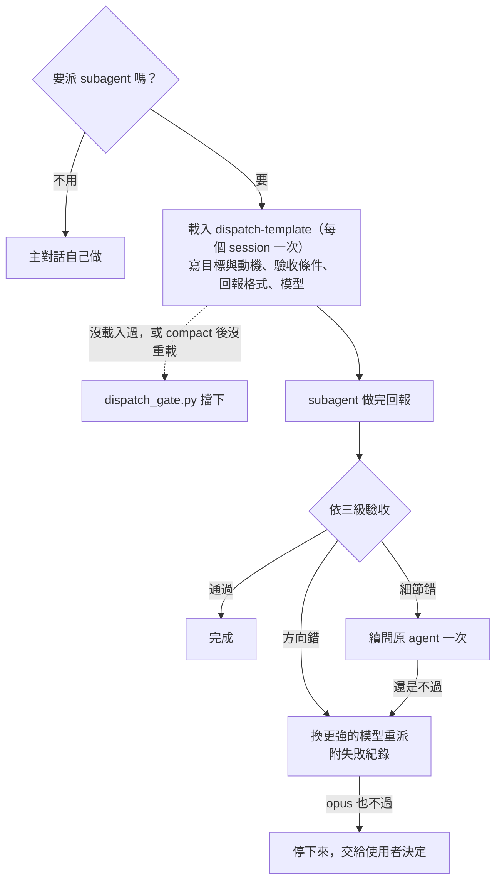

繁體中文 | [English](README.en.md)

# claude-workflow-template

給研究生用的 Claude Code 工作流程設定，裝進你自己的專案資料夾（論文、文獻筆記、報告）就能用。裝好之後：

- **開 session 會接上次的進度**：Claude 開場先讀上次的紀錄，用一兩句話告訴你做到哪、還剩什麼。
- **派 subagent 前要先寫清楚**：Claude 要把工作交給 subagent 時，得先載入派工模板，寫明目標、驗收條件和回報格式；沒載入就會被擋下。
- **做完的東西由另一個 agent 驗收**：重要的產出（論文段落、對外發布的內容）交給沒參與製作的 `verifier` 檢查，做的人不驗自己的活。
- **幾個常見錯誤有自動把關**：檔案裡混進看不見的控制字元會被擋下；對話太長時會提醒你先存進度。
- **原始資料可以上鎖**：安裝時指定的資料夾或檔案（PDF、問卷原始檔），Claude 用編輯工具或 `>` 重導向都改不了（Python 等腳本自己開檔寫入擋不到）。

幾個名詞：**hook** 是 Claude Code 在特定時間點（開場、使用工具前、回合結束）自動執行的小程式，可以補充資訊給 Claude，也可以擋下動作。**subagent** 是 Claude 另外開的一個助手，在自己的對話裡做完一件事再回報。**context** 是 Claude 目前這段對話記得的內容，太長時要用 `/clear` 清掉重來。

介紹頁：<https://wayhong0928.github.io/claude-workflow-template/>

## 適合誰

- 用 Claude Code（終端機版），專案會跨很多個 session。
- 專案以寫作和研究為主：論文、文獻筆記、報告。程式專案也能用，但純寫程式的話，[Superpowers](https://github.com/obra/superpowers) 這類套件比較合適（差異見 [docs/vs-superpowers.md](docs/vs-superpowers.md)）。
- 平台：Windows 原生在實機上跑過；WSL2（Ubuntu）跑過 hook 與安裝程式的測試；macOS 只做過靜態檢查。hook 和 session_log 的腳本都是 Python，不需要 PowerShell。

不需要會 Git。改壞了怎麼還原，見[改壞了怎麼還原](#改壞了怎麼還原)。

## 安裝前：確認環境

| 工具 | 用來做什麼 | 必要嗎 | 怎麼檢查 | 沒有的話 |
|---|---|---|---|---|
| Claude Code 2.1.292 以上 | 這套設定就是給它用的 | 必要 | `claude --version` | 照[官方說明](https://code.claude.com/docs/en/setup)安裝。更新：原生安裝用 `claude update`，WinGet 裝的用 `winget upgrade Anthropic.ClaudeCode`，Homebrew 裝的用 `brew upgrade claude-code` |
| Python 3.8 以上 | 所有 hook、session_log 腳本、安裝程式 | 必要 | Windows：`python --version`（或 `py --version`）；macOS、Linux、WSL：`python3 --version` | Windows：`winget install Python.Python.3.12`；macOS：`brew install python`；Ubuntu／WSL：`sudo apt install python3` |
| Git | 用備用裝法時下載這個 template | 不必要 | `git --version` | 改用下載 ZIP |

Windows 上打 `python` 如果跳出 Microsoft Store，代表還沒裝 Python，那只是系統內建的捷徑。

**用 WSL 的話**：Claude Code、Python 都在 WSL 裡面跑，專案也放在 WSL 這一側。hook 用的 Python 指令名是照當下環境設的，在 WSL 裝好的設定拿到 Windows 原生的 Claude Code 用會失效，反過來也一樣（見[已知限制](#已知限制)）。

## 安裝：讓 AI 幫你裝成 plugin（建議）

在**你的專案資料夾**開 Claude Code（在那個資料夾開終端機，打 `claude`），把下面整段貼給它。每一步它都會先說要跑什麼，等你同意才做。

```text
請幫我在目前這個資料夾裝 workflow-kit（https://github.com/wayhong0928/claude-workflow-template）。每一步先說要跑什麼指令，等我同意再做。
1. 檢查 claude --version 要 2.1.292 以上；Python 依序試 python、python3、py（py 只在 Windows 試），要 3.8 以上，Windows 上跳出 Microsoft Store 或印出 "Python was not found" 算沒有。缺哪個就停下來告訴我怎麼裝。
2. 跑 claude plugin marketplace add wayhong0928/claude-workflow-template
3. 跑 claude plugin install workflow-kit@workflow-kit --scope project --config python=<第 1 步找到的 Python 指令>
4. 請我關掉 Claude Code、在同一個資料夾重開，再打 /workflow-kit:setup，照它的問題一題一題回答。
```

`--scope project` 只在這個資料夾啟用，別的專案不受影響。`--config python=` 一定要給，沒設的話 hook 全都不會跑。setup 會建 `CLAUDE.md`、`session_log.md`、`TODO.md` 和派工規則檔，問你要鎖哪些資料夾；寫進 `.claude/` 的檔，Claude Code 會先問你要不要允許，這是正常的。

**做完後你要檢查**：重開 `claude`，打 `/hooks`，看得到 workflow-kit 的 6 個 hook（`PreToolUse`、`PostToolUse`、`UserPromptExpansion`、`UserPromptSubmit`、`Stop`、`SessionStart`）。

### 公司電腦擋外部套件來源時

公司或學校管理的電腦，管理員可以用 `strictKnownMarketplaces` 限制只能從核准的來源裝 plugin（官方 [plugins/org](https://code.claude.com/docs/en/plugins/org#restrict-what-users-can-install)），這時第 2 步會失敗。改用下面的備用裝法，它只把檔案複製進你的專案，不經過 plugin 系統。公司如果禁止從外部下載程式，先問過 IT 再裝。

### 更新

- plugin：跑 `claude plugin marketplace update workflow-kit`，再跑 `claude plugin update workflow-kit@workflow-kit`，重開 Claude Code。hook、skill、verifier 會換成新版；setup 複製進專案的 `.claude/rules/dispatch-and-verify.md` 不會跟著換，想換就請 Claude 比對它和新版的差異再決定。
- 備用裝法：下載新版，照下面的步驟再跑一次 install.py，它會先備份再覆蓋。

## 備用：用 install.py 裝

公司電腦裝不了 plugin、或想把所有檔案都放在專案裡自己管，用這條。在**你的專案資料夾**開 Claude Code 或 Codex（打 `claude` 或 `codex`），把下面整段貼給它。它會先檢查環境、缺什麼先問你要不要裝，每一步都等你同意才做。已經用 plugin 裝過的專案不要再跑這條，install.py 偵測到會停下來。

用 Codex 裝也可以，但裝好的東西只在 Claude Code 裡有作用：Codex 讀的是 `AGENTS.md`、`.agents/skills/`、`.codex/hooks.json`，不讀 `.claude/`。Codex 預設的沙箱不能連網、只能寫目前的資料夾，所以下載 template 到暫存資料夾時，它會先請你核准。

```text
請幫我把 claude-workflow-template（https://github.com/wayhong0928/claude-workflow-template）裝進目前這個資料夾。每一步先說你要做什麼、要跑什麼指令，等我同意再做。不要自己改我專案裡原本的檔案，所有修改都交給它的 install.py（它會先備份）。

1. 檢查環境，逐項回報「有／沒有」和版本：
   - 作業系統，以及是不是在 WSL 裡（Linux 上 /proc/version 含 microsoft 就是 WSL）。在 WSL 裡的話，下面的 claude 和 python3 都要是 WSL 裡裝的，不是 Windows 那一側的。
   - Claude Code：claude --version，要 2.1.292 以上。
   - Python：依序試 python、python3、py（Windows 才試 py），要 3.8 以上。Windows 上如果跳出 Microsoft Store 或印出 "Python was not found"，算沒有。
   - Git：git --version。
2. 沒有 Python 或 Claude Code 版本太舊：停下來，告訴我怎麼裝或更新（Python：Windows 用 winget install Python.Python.3.12，macOS 用 brew install python，Ubuntu／WSL 用 sudo apt install python3；Claude Code：看它是怎麼裝的，原生安裝用 claude update，WinGet 用 winget upgrade Anthropic.ClaudeCode，Homebrew 用 brew upgrade claude-code），問我要不要現在做。我說不要，就到此結束。
3. 沒有 Git：問我要不要裝（Windows：winget install Git.Git；macOS：xcode-select --install；Ubuntu／WSL：sudo apt install git）。我說不要也沒關係，下一步改下載 ZIP。
4. 把 template 下載到暫存資料夾，不要放進我的專案。有 Git 就用 git clone --depth 1；沒有就下載 https://github.com/wayhong0928/claude-workflow-template/archive/refs/heads/main.zip 再解壓縮。
5. 問我要不要裝 session_log（每次開 session 自動接上次的進度，會在專案裡多出 session_log.md 和 TODO.md）。給我一句建議：這個資料夾不是 git repo（例如論文資料夾、Obsidian 筆記庫）就建議裝；是程式 repo 的話可以不裝。再問我有沒有不能讓你改的原始資料（PDF、問卷原始檔、已送審的文件），有的話列出資料夾或檔案。
6. 先預演：python <暫存資料夾>/install.py <我的專案資料夾> --dry-run，加上 --session-log 或 --no-session-log；第 5 步列出的原始資料，每個路徑加一個 --protect <路徑>。把它列出的動作講給我聽；我同意後，拿掉 --dry-run 正式執行。指令裡的 python 換成第 1 步找到的那個。
7. 在我的專案資料夾跑 python .claude/hooks/tests/run_tests.py（python 一樣換成第 1 步找到的那個），最後一行要是「31/31 通過」（前後數字一樣就是全過）。沒通過就把輸出貼給我，不要自己改 hook。
8. 如果 install.py 說它新建了 CLAUDE.md：一次問我一題，把裡面的【】填完；我答不出來的那一行就刪掉。
9. 刪掉暫存資料夾。回報：裝了什麼、哪些原本就有、備份放在哪、哪一步失敗或被我跳過。最後提醒我關掉 Claude Code，在專案資料夾重新打 claude，再打 /hooks 確認。
```

**AI 做完後你要檢查**：在專案資料夾重新打 `claude`，再打 `/hooks`，看得到 `PreToolUse`、`PostToolUse`、`UserPromptExpansion`、`UserPromptSubmit`、`Stop` 五類（裝了 session_log 會多一個 `SessionStart`）。

### 不用 AI，自己跑 install.py

下面的指令以 Windows 為例。macOS、Linux、WSL 把 `python` 換成 `python3`，路徑換成 `~/thesis/notes` 這種寫法。

1. 下載：按這頁上方綠色的 **Code** → **Download ZIP**，解壓縮到任何地方（不要解壓縮到你的專案裡）。會用 Git 的話，`git clone` 也可以。
2. 在解壓縮出來的資料夾打開終端機（Windows：在資料夾空白處按右鍵，選「在終端機中開啟」；macOS：開「終端機」，打 `cd `（後面有空格）再把資料夾拖進視窗、按 Enter；Linux、WSL：用 `cd` 切過去），先預演（路徑換成你的專案）：

   ```
   python install.py "D:\碩論\筆記" --session-log --dry-run
   ```

   它會列出要新增幾個檔案、覆蓋哪些檔案、改哪些設定，不會真的動。不想裝 session_log 就把 `--session-log` 換成 `--no-session-log`；兩個都不寫，它會自己判斷（專案不在 git repo 裡就裝）。有不能改的原始資料，加上 `--protect pdf` 這類參數（見[保護原始資料](#保護原始資料)）。
3. 確認沒問題，拿掉 `--dry-run` 再跑一次。
4. 在終端機用 `cd "D:\碩論\筆記"` 切到你的專案資料夾，跑 `python .claude/hooks/tests/run_tests.py`，最後一行要是「31/31 通過」（前後數字一樣就是全過）。
5. 打開專案裡的 `CLAUDE.md`，把【】填完（install.py 有新建它的話）。
6. 在專案資料夾打 `claude`，再打 `/hooks` 確認。

### install.py 會做什麼

- 把 `template/.claude/` 底下的檔案複製到你專案的 `.claude/`。
- 把 hook 設定合併進 `.claude/settings.json`。你原本的設定都保留，只加這幾項。有給 `--protect` 的話，也在同一個檔案的 `permissions.deny` 加上保護規則。
- 專案沒有 `CLAUDE.md` 才新建一份。專案原本有 `AGENTS.md` 的話，新建的 CLAUDE.md 第一行是 `@AGENTS.md`，把它匯入；不這樣做，有了 CLAUDE.md 之後 Claude Code 就不會再自動讀 AGENTS.md。裝 session_log 時，在 CLAUDE.md 結尾加一段接力說明，前後有 `<!-- claude-workflow-template:start -->`、`<!-- claude-workflow-template:end -->` 標記。
- 裝 session_log 時，專案沒有 `session_log.md`、`TODO.md` 才各建一份。
- 專案在 git repo 裡時，`.gitignore` 加上 hook 執行時產生的本機狀態檔。

覆蓋或修改前，舊檔會先備份到 `.claude/backup/workflow-template-<時間>/`。重複執行不會重複加設定，所以之後要更新，下載新版再跑一次就好。

### 移除

```
python install.py "D:\碩論\筆記" --uninstall
```

會拿掉 settings.json 裡這個 template 的 hook、`.claude/` 裡它裝的檔案，以及 CLAUDE.md 裡標記的那一段。`permissions.deny` 的保護規則不會拿掉，原始資料繼續受保護，不需要的話自己從 settings.json 刪。`CLAUDE.md`、`session_log.md`、`TODO.md` 是你的內容，不會刪。settings.json 原本只有這些 hook 的話，會剩下一個內容是 `{}` 的空檔，可以刪掉；`.claude/backup/` 裡是安裝和移除前的備份，確定不要了也可以刪。

## 裝好之後怎麼用

王小明的碩論文獻筆記放在一個 Obsidian 資料夾，沒有用 Git。

1. 照上面裝好，選擇裝 session_log。CLAUDE.md 這樣填：
   - 這個專案是什麼：「你是王小明的文獻筆記助理。專案目標：每篇讀過的論文都有一份筆記，標出研究問題、方法、主要發現。」
   - 不能違反的規則：「引用一律 APA 第七版」。`pdf/` 不能改，所以安裝時加了 `--protect pdf`，交給 Claude Code 擋，不靠 Claude 記得。
2. 每次都在筆記資料夾打 `claude`，不然 hook 和 CLAUDE.md 載不到。
3. 開場 Claude 會先說上次做到哪。照常交代工作就好。
4. 一段工作做完，跟 Claude 說「補 log」，它會照格式在 `session_log.md` 最上面加一筆，並更新 `TODO.md`。下次開 session，開場就會看到這一筆。
5. Claude 要派 subagent 時，你會看到它先載入 `dispatch-template`；重要的產出，它會派 `verifier` 驗收後才說完成。

session_log 每筆的格式和寫法見 [template/.claude/session-log-kit/README.md](template/.claude/session-log-kit/README.md)；每個機制在什麼時候發生，見 [docs/how-it-works.md](docs/how-it-works.md)。

### 派工到驗收



## 保護原始資料

PDF、問卷原始檔、已送審的文件這類不能改的東西，安裝時用 `--protect` 鎖住，資料夾或檔案都可以，給幾次都行：

```
python install.py "D:\碩論\筆記" --session-log --protect pdf --protect "data\問卷原始檔.csv"
```

它會在 `.claude/settings.json` 加上這樣的設定：

```json
"permissions": {
  "deny": ["Edit(/pdf/**)", "Edit(/data/問卷原始檔.csv)"]
}
```

`/pdf/**` 指專案裡 `pdf/` 底下所有檔案；專案外的路徑會寫成 `//d/research-data/**` 這種絕對路徑。Claude 用編輯工具改檔、用 `>` 把輸出寫進去，都會被 Claude Code 擋下，略過權限詢問的模式也一樣（在 Windows 上實測過 Write、Edit、`>` 三種）。之後要加，帶著 `--protect` 再跑一次 install.py，已經有的規則不會重複加；也可以直接照上面的格式改 settings.json。

擋不到的情況：Claude 寫一支 Python 之類的腳本，由腳本自己開檔寫入。官方 [permissions 文件](https://code.claude.com/docs/en/permissions#read-and-edit)寫明這類間接寫入不在範圍內，要連這種都擋，得開作業系統層級的 [sandbox](https://code.claude.com/docs/en/sandboxing)，它只支援 macOS、Linux、WSL2。所以重要的原始檔，在專案外另留一份備份。

寫在 CLAUDE.md 的「不得修改 `pdf/`」只是提醒，Claude 不一定每次照做；要真的擋，用 `--protect`。

## 改壞了怎麼還原

Claude Code 每次你送出訊息都會存一個檢查點。檔案被改壞時，打 `/rewind`（或在輸入框是空的時候按兩下 `Esc`），選回到哪一則訊息之前，再選要還原程式碼、對話或兩者。詳見官方 [checkpointing 文件](https://code.claude.com/docs/en/checkpointing)。

`/rewind` 救不回來的情況：

- Claude 用指令改的檔案（`rm`、`mv`、`cp`、腳本寫檔），只有它用編輯工具改的才追蹤得到。
- subagent 改的檔案，多數情況不會還原。
- 你自己在 Claude Code 外面改的檔案。
- 檢查點的檔案快照預設大約 30 天後清掉。

所以長期的版本紀錄還是要另外留：會用 Git 的話，在專案資料夾 `git init`，每段工作做完請 Claude commit 一次；不用 Git 的話，至少在大改之前複製一份資料夾。

## 核對引用與主張

論文段落、文獻筆記寫完，請 Claude 派 `verifier` 核對引用。`verifier` 沒參與寫作，只拿到驗收條件和檔案路徑。條件寫得越具體，查得越準：

```text
派 verifier 核對 chapters/ch2.md 的引用：
1. 文中每筆（作者，年）在 references.md 都找得到，references.md 每筆也都有在文中出現。
2. 每筆引用旁邊的說法，跟 pdf/ 裡那篇原文講的一致；不一致的，列出原文那一句。
3. references.md 每筆有 DOI 的，DOI 頁面的作者、年份、標題跟 references.md 寫的一致。
```

它是讀檔和上網逐筆查，沒有自動化腳本，所以：

- 付費牆後面的論文它讀不到全文，會標「無法判定」。把 PDF 放進專案、在條件裡寫路徑，它才對得到原文。
- 它也會看漏。回報「通過」的引用，要寫進論文的關鍵主張仍要自己抽查幾筆。

## 長任務：先規劃，再用 `/goal` 跑到完成

改一整章、整理一批文獻筆記這類會動到很多檔案的工作，先讓 Claude 規劃、你確認，再讓它自己跑到驗收條件都滿足。自己也還沒想清楚要寫什麼的話，先讓 Claude 訪談你、寫出大綱。步驟見 [docs/how-it-works.md 的「大的工作」](docs/how-it-works.md#大的工作先讓-claude-訪談你)與[「長任務」](docs/how-it-works.md#長任務先規劃再用-goal-跑到完成)。

## repo 裡有什麼

```
.claude-plugin/            plugin 與 marketplace 的設定檔
plugin/                    plugin 專用的 hook 設定、setup skill
todo/                      /todo 側欄（另一個 plugin，選用）
install.py                 備用裝法：安裝與移除
template/                  兩種裝法共用的檔案
  .claude/
    hooks/                 四支 hook、一支共用模組、測試
    skills/dispatch-template/  派工 prompt 模板、模型選型表
    agents/verifier.md     驗收用的 subagent
    rules/dispatch-and-verify.md  什麼時候派 subagent、怎麼驗收
    session-log-kit/       session_log 的注入、寫入、歸檔腳本
  hooks-core.json          install.py 合併進 settings.json 的 hook 設定
  hooks-session-log.json   同上，session_log 用
  CLAUDE.md.template       新建 CLAUDE.md 時用
  session_log.md.template、TODO.md.template
docs/
  how-it-works.md          一個 session 照什麼順序發生、要不要裝 session_log、怎麼改成自己的版本
  vs-superpowers.md        跟 Superpowers 的差異
tests/test_install.py      install.py 的測試
index.html                 介紹頁
README.md、README.en.md    說明文件（繁體中文、英文）
```

在這個 repo 的資料夾裡開 `claude` 不會啟用任何 hook，東西都放在 `template/` 底下，裝進你的專案才會生效。

## 已知限制

- `rules/` 和 `dispatch-template` 是寫給 Claude 看的規則，它不一定每次都照做；會強制的只有 hook 那幾項。
- hook 全部 fail-open：出錯時一律放行，不會卡住你，但壞掉時也不會有提示。改了 hook 請跑測試。
- `ctrl_char_stop.py` 只檢查得到 transcript 裡有完整路徑的檔案：指令裡用變數組出來的路徑會漏掉，macOS、Linux 上含空白的路徑要有引號包住才抓得到。subagent 寫的檔案記在另一份 transcript，也不在檢查範圍。同一回合最多擋 1 次。
- 連內建的 `Explore`、`Plan` subagent 也要先載入 `dispatch-template` 才能派（只有 `fork` 免檢），所以進 plan mode 後第一次派工可能會被擋一次，載入模板後就會放行。
- hook 用的 Python 指令名是照安裝當下的環境設的（Windows 常是 `python`，macOS、Linux 常是 `python3`）。plugin 版記在 `--config python=`，可以用 `/plugin configure workflow-kit@workflow-kit` 改；install.py 版寫在 `.claude/settings.json`。同一個專案資料夾同時從 Windows 和 WSL 開，或用雲端硬碟在 Windows 和 Mac 之間同步，另一邊的 hook 會全部失敗，派工檢查也跟著失效。
- 實機測試範圍：Claude Code 實機只在 Windows 原生跑過；hook 與安裝程式的測試在 Windows 和 WSL2（Ubuntu）都跑過；macOS 還沒測。
- `--protect` 的保護規則擋不到腳本自己開檔寫入（見[保護原始資料](#保護原始資料)）；路徑裡有 `*`、`?`、`[`、`]` 的話，install.py 不會幫你寫，請手動加。
- 只支援 Claude Code。Codex 可以幫你執行安裝，但它不讀 `.claude/`：規則要放 `AGENTS.md`，skill 要放 `.agents/skills/`，hook 要放 `.codex/hooks.json`。派工檢查靠 Claude Code 的 Skill 工具事件，控制字元檢查要讀 Claude Code 的 transcript（Codex 官方文件寫明它的 transcript 格式不是穩定介面），這兩支 hook 不能直接搬過去用。

## 回報問題

裝不起來、hook 誤擋或該擋沒擋，請到 [Issues](https://github.com/wayhong0928/claude-workflow-template/issues) 回報，附上作業系統和 `install.py` 或測試的輸出。

## 同系列

| 資源 | 適合誰 |
|---|---|
| [mis-thesis-guide](https://wayhong0928.github.io/mis-thesis-guide/) | 研究方法與論文寫作的知識庫，查觀念、查判準 |
| [一小時上手](https://wayhong0928.github.io/mis-thesis-guide/pages/ai-quickstart.html) | 只用 ChatGPT、Claude、Gemini 網頁版，想在一小時內建好論文助手（另有 [Claude Code、Codex 版](https://wayhong0928.github.io/mis-thesis-guide/pages/ai-quickstart-agent.html)） |
| [thesis-notes-template](https://github.com/wayhong0928/thesis-notes-template) | 想用 Obsidian 做文獻筆記，要現成的模板和填寫規則 |
| [mis-thesis-skills](https://github.com/wayhong0928/mis-thesis-skills) | 用 Claude Code 或 Codex，想讓 AI 照固定判準檢查題目與寫作 |
| [claude-workflow-template](https://github.com/wayhong0928/claude-workflow-template) | 用 Claude Code 做論文或研究專案，想要現成的工作流程設定：接續進度、派工模板、獨立驗收 |

## 授權

MIT，見 [LICENSE](LICENSE)。
