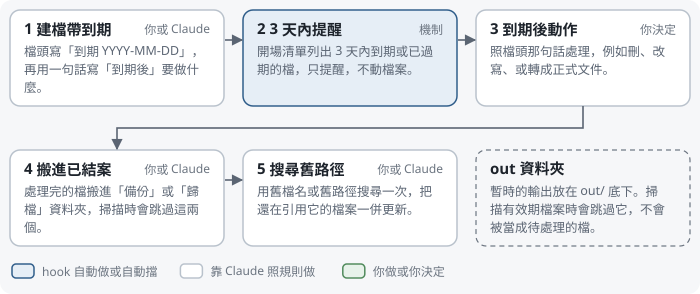

# 檔案慣例：命名、有效期、out 資料夾、結案搬移

專案做久了，計畫、草稿、交接檔會越積越多。這頁是四條放檔的慣例，照不照做由你決定。template 沒有裝任何會搬檔或改檔的 hook；todo plugin 會用到其中兩條（讀檔頭的到期日、不掃 `out/`），而且只讀不寫。

## 1. 檔名寫類型、日期時間、主題

格式是 `類型_YYYY-MM-DD-HHMM_主題.md`，放進主題資料夾，不堆在專案根目錄。類型用固定幾個詞就好，例如計畫、研究、評估、交接、草稿。

例子：

```
期末報告/
├── 計畫_2026-11-03-1430_第二章文獻整理.md
└── 研究_2026-11-05-0910_問卷量表比較.md
```

同一天做好幾份時，時間讓檔名照建立順序排。檔案總管照名稱排序，看到的就是時間軸。

## 2. 有期限的檔寫「到期」和「到期後」

計畫、預跑、交接這類用完就該收的檔，在檔頭加兩行：

```
---
到期: 2026-11-10
到期後: 第二章寫完就結案，本檔搬進 備份/已結案文件/
---
```

`到期` 寫完整日期。`到期後` 用一句話寫到時候怎麼處理，看到提醒的人（你或 Claude）就不用回頭翻內容。

有裝 todo plugin 的話，開場清單會列出 3 天內到期和已經過期的檔，只提醒，不移動也不修改檔案。`todo_core.py` 每個檔只讀前 4 KB，所以這兩行要放在檔頭。

## 3. 無人值守的產出放 out/

你不在旁邊時產出的檔，例如派 subagent 或背景任務寫的草稿，一律寫進 `out/`（專案底下或主題資料夾底下都可以），驗收過再搬到正式位置。沒驗收的草稿就不會混進正式文件，結果不能用時清掉 `out/` 就好。

例子：派 subagent 整理三篇文獻，在派工 prompt 寫「產出寫到 `期末報告/out/文獻整理_草稿.md`」。驗收過後，把內容併進正式的 `期末報告/研究_2026-11-05-0910_問卷量表比較.md`。

todo plugin 掃有效期檔時會跳過 `out/`、`備份/`、`歸檔/` 這幾個資料夾。

## 4. 結案搬進 備份/已結案文件/，搬完搜尋舊路徑

到期後處理完的檔，搬進 `備份/已結案文件/`，不刪。搬完用舊檔名搜尋整個專案，把還在引用它的檔一起改掉或標「已結案」，常見的有 CLAUDE.md 的路由表、TODO、session_log 和其他計畫。

例子：

```
grep -rn "計畫_2026-11-03-1430_第二章文獻整理" .
```

只改路由表的話，其他地方漏掉的引用會讓下一個 session 照著舊路徑去找，結果找不到檔。

## 有效期檔案的一生

<figure>
<picture>
<source media="(max-width: 560px)" srcset="img/6-lifecycle-narrow.svg">

</picture>
<figcaption>有效期檔案的一生。只有第 2 步「3 天內提醒」是機制自動做的，其他步驟由你或 Claude 照這頁的慣例做。</figcaption>
</figure>

template 不附自動搬檔的 hook。作者自己的環境有一支開場 hook，會把過期超過 7 天的檔自動搬進 `備份/已結案文件/`；它會動你的檔，所以公開版不預設裝。需要的話，可以讀 `todo_core.py index` 產生的 `todo_index.json`，用裡面的 `expiring` 欄位自己寫一支。
